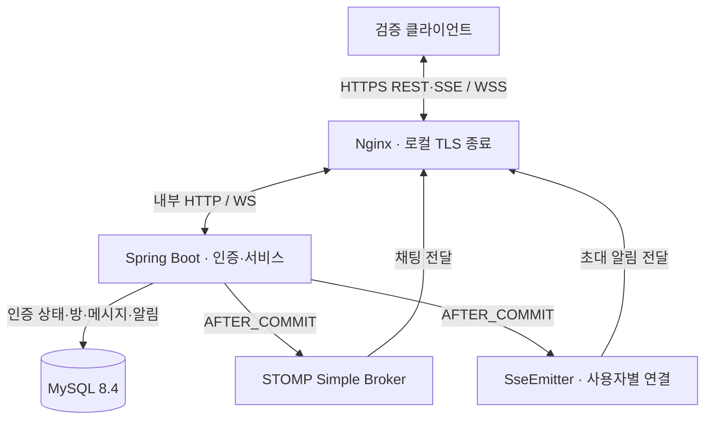

# Realtime Chatting API

JWT 인증 기반의 **WebSocket/STOMP 채팅·SSE 방 초대 알림 백엔드**입니다.

- **인증·접근 제어:** JWT/RTR·CSRF, 방별 전송·구독 권한, 토큰 만료·로그아웃에 따른 연결 종료
- **전달·복구:** DB 커밋 후 실시간 전달, 재연결 후 REST 이력 조회와 ID 중복 제거
- **검증 결과:** 2026-11-13 기준 Java 76건·JavaScript 12건, **총 88건 통과** (실패·오류·건너뜀 0건)

개인 프로젝트이며 **단일 서버·로컬 CA 기반 HTTPS/WSS 환경**에서 검증했습니다. 공개 서비스 배포는 포함하지 않습니다.

## 목적과 범위

기존 REST API 프로젝트에서 다룬 인증·트랜잭션을 지속 연결로 확장했습니다. 연결이 유지되는 동안 인증 상태 변경을 반영하고, DB 저장·실시간 전달·재연결 이후 복구를 각각 구분해 구현하고 검증하는 것이 목적입니다. Chapter 1~4에서 인증·채팅·알림과 기본 복구를 구현하고, Nginx를 통한 로컬 TLS·프록시 동작까지 확인했습니다.

## 기술 스택

| 기술 | 사용 목적 |
|---|---|
| Java 21 · Spring Boot 4.1.2 · Gradle Wrapper 9.8.2 | 애플리케이션 실행·빌드 |
| Spring MVC · Validation | REST API, 입력 검증, `SseEmitter` 알림 |
| Spring Security · Security Messaging · BCrypt | HTTP·STOMP 접근 제어, CSRF 방어, 비밀번호 해시 |
| JJWT 0.13.0 | 서명·issuer·만료·토큰 용도 검증 |
| Spring WebSocket · STOMP Simple Broker | 방별 양방향 채팅, heartbeat |
| Spring Data JPA · MySQL 8.4 · Flyway | 인증 상태·채팅·알림 저장, 비관적 락, 스키마 버전 관리 |
| Nginx 1.30.6 · Docker Compose · OpenSSL | 로컬 TLS 종료, WS·SSE 프록시, 인증서 생성·검증 |
| JUnit Jupiter · MockMvc · Testcontainers · Node test runner | 실제 MySQL·HTTP·WS·SSE·HTTPS 및 클라이언트 복구 검증 |


## 시스템 아키텍처



TLS는 Nginx에서 종료하며 Nginx와 앱 사이는 평문 HTTP·WS입니다. TLS용 Compose 구성은 앱 포트를 호스트에 공개하지 않습니다. 브로커 구독과 WS·SSE 연결 레지스트리는 앱 메모리에 있습니다.

## 주요 구현

| 해결하려는 문제 | 구현 방식과 범위 |
|---|---|
| Access·Refresh의 용도 혼용 | JWT의 `purpose`를 구분하고 서명·issuer·만료를 검증합니다. 기본 수명은 Access 15분, Refresh 7일입니다. |
| Refresh 재사용과 동시 재발급 | 사용자당 Refresh 해시 한 행을 저장합니다. 사용자 행 → Refresh 행 순서로 잠근 뒤 해시를 비교·교체하며, 동일 Refresh의 동시 요청 두 건 중 하나만 성공하는 테스트가 있습니다. 이전 토큰 재사용 시 401이며 토큰 패밀리 전체 폐기는 구현하지 않았습니다. |
| 로그아웃 뒤 남은 토큰·연결 | Refresh 삭제와 `tokenVersion` 증가를 같은 트랜잭션에서 처리합니다. HTTP 요청과 STOMP 접근·전달, SSE 쓰기에서 현재 버전을 검사하며, 커밋 후 이벤트로 이전 버전 연결을 종료합니다. 연결별 만료 예약도 둡니다. |
| 쿠키 인증 요청의 CSRF | Refresh는 `HttpOnly`·`SameSite=Strict`·`Path=/api/auth` 쿠키로 전달합니다. 변경 요청에는 CSRF 쿠키와 `/api/auth/csrf`가 반환한 헤더명·토큰을 함께 사용하고, STOMP CONNECT에도 CSRF를 검증합니다. TLS 프로필은 Secure 쿠키를 강제합니다. |
| 연결 성공과 방 접근의 혼동 | `/ws` Upgrade 이후 CONNECT에서 JWT를 인증합니다. SEND·SUBSCRIBE마다 허용 목적지와 방 참여 여부를 검사하고, outbound 메시지도 재검사합니다. 발신자는 본문 대신 인증 정보에서 결정합니다. |
| 롤백될 메시지의 선전송 | 메시지 저장 트랜잭션에서 이벤트를 발행하고 `AFTER_COMMIT`에서만 브로커에 전달합니다. 전송 성공이나 장애 시 재시도까지 보장하는 구조는 아닙니다. |
| 사용자별 알림과 오프라인 데이터 | 방 생성 시 작성자를 제외한 참여자에게 `ROOM_INVITED` 알림을 저장하고 커밋 후 SSE로 전달합니다. 새 채팅 메시지 알림·읽음 처리·초대 수락/거절은 구현하지 않았습니다. |
| 연결 중단 이후 화면 복구 | 검증 화면은 WS 재구독·SSE `ready` 이후 `afterId` 이력을 조회합니다. `RecoveryLedger`가 이력 페이지 커서와 실시간 수신 ID를 구분하고 같은 ID를 한 번 표시합니다. 연속 실패 시 1·2·4초 간격으로 재시도하며, 성공 후 횟수를 초기화하고 로그아웃·재발급 실패 시 중단합니다. |

### 주요 문제 해결

- **동시 최초 로그인 교착 상태:** 기존 기록에서 Refresh 행이 없는 상태의 잠금 조회와 INSERT 경합을 재현했습니다. 이미 확보한 사용자 행 잠금은 유지하고 로그인 경로의 Refresh 조회를 일반 조회로 바꿨습니다. 서로 다른 두 사용자의 동시 최초 로그인을 6회 반복하는 회귀 테스트가 있습니다.
- **SSE 인증 후 변경 요청 403:** 브라우저에서 캐시한 CSRF로 방 생성이 거부되는 현상을 확인했습니다. 검증 화면이 변경 요청마다 CSRF를 다시 조회하도록 처리하고, 실제 쿠키·로그인·SSE·방 생성·로그아웃 흐름을 테스트했습니다. 쿠키 변경의 모든 내부 원인을 확정한 것은 아닙니다.
- **HTTPS 프록시와 지속 연결:** 외부 Host·scheme·port를 전달하고 클라이언트의 Forwarded 헤더를 제거·덮어씁니다. WS Upgrade 전달과 SSE buffering 해제를 별도로 설정했습니다. SSE 읽기 제한을 heartbeat보다 짧게 설정한 실험에서는 반복 단절을 관찰했습니다.

## API와 실시간 목적지

| 방식 | 경로 | 용도 |
|---|---|---|
| GET | `/api/auth/csrf` | CSRF 쿠키·헤더 토큰 준비 |
| POST | `/api/auth/signup` | 회원가입 |
| POST | `/api/auth/login` | 로그인 |
| POST | `/api/auth/refresh` | Access·Refresh 재발급 및 Refresh Token Rotation |
| POST | `/api/auth/logout` | 로그아웃 및 토큰 무효화 |
| POST / GET | `/api/rooms` | 참여자를 지정한 방 생성 / 내 방 목록 |
| GET | `/api/rooms/{roomId}/messages` | `beforeId` 내림차순 또는 `afterId` 오름차순 이력 |
| GET | `/api/notifications` | 본인 초대 알림의 `afterId` 이력 |
| GET | `/api/notifications/stream` | `fetch` 스트리밍·Bearer 인증 SSE (`ready`, `notification`, heartbeat comment) |
| WebSocket | `/ws` | STOMP 1.2 연결, SockJS 미사용 |
| STOMP SEND | `/app/rooms/{roomId}/messages` | 본문 `{"content":"메시지"}` |
| STOMP SUBSCRIBE | `/topic/rooms/{roomId}` | 참여 중인 방 메시지 수신 |

이력 `limit`는 기본 20, 최대 100입니다. `beforeId`와 `afterId`는 동시에 사용할 수 없습니다. 방 생성으로 참여자가 바로 등록되며 별도 참여자 추가·퇴장 API는 없습니다.

검증 화면의 SSE는 `chat-test.js`에서 `fetch`에 `Authorization: Bearer <Access Token>` 헤더를 지정하고 응답 스트림을 읽습니다. `recovery-client.mjs`의 `SseParser`가 UTF-8·개행 경계를 처리해 이벤트를 분리합니다. 서버는 `JwtAuthenticationFilter`에서 Access Token을 검증하고, 인증된 사용자에게 `SseEmitter`로 알림을 전달합니다.

## 테스트와 검증 결과

**2026-11-13 최종 실행 기록: 총 88건 통과, 실패·오류·건너뜀 0건.** 기본 `build`의 Java 67건·JavaScript 12건과 별도 `proxyTest` 9건을 합친 결과입니다. 저장된 JUnit XML·최종 빌드 로그를 현재 테스트 목록에 대조했으며, 반복 실행과 수동 검증은 건수에 포함하지 않았습니다.

| 구분 | 통과 | 검증 범위 |
|---|---:|---|
| Chapter 1 | 29 | MySQL·Flyway, JWT·RTR·동시 재발급, CSRF, 방 권한·커서 |
| Chapter 2 | 21 | 실제 WS 송수신, CONNECT·방 인가, 만료·로그아웃·heartbeat, 롤백·동시 로그인 |
| Chapter 3 | 17 | 실제 SSE, 알림 격리, 단절·만료·복구, 쿠키 CSRF 흐름 |
| JavaScript | 12 | SSE 파서, ID 중복 제거·페이지 커서, 실패 후 재시도 |
| Chapter 4 (`proxyTest`) | 9 | 실행 중인 Nginx 대상 인증서 검증·WSS·HTTPS SSE·Secure 쿠키·프록시 헤더 |

기존 **50건**은 Chapter 1·2까지의 결과입니다. 수동 기록에는 두 브라우저의 채팅·초대 알림·오프라인 이력 복구, 로컬 CA를 신뢰한 HTTPS, TLS 1.2/1.3 및 TCP·TLS 패킷 관찰이 있습니다. 공개 인터넷 장애나 대규모 부하 검증은 아닙니다.

2026-11-14 문서 정리 시 JavaScript 12건은 재실행해 모두 통과했습니다. Java 통합 테스트와 `proxyTest`는 실행 환경 제약으로 재실행하지 못했으므로, 위 88건은 이전 실행 기록으로 구분합니다.

## 실행 방법

### 로컬 HTTP: macOS / Linux

JDK 21, Docker Compose, Node.js가 필요합니다. `.env`가 없는 새 checkout에서 아래와 같이 준비합니다. 이미 있으면 기존 파일을 유지합니다.

```bash
cp .env.example .env
```

`.env`의 비밀값을 직접 설정합니다. 파일은 Git에서 제외됩니다.

| 환경 변수 | 용도·기본값 |
|---|---|
| `DB_PASSWORD` | Compose의 `chatting` 계정과 앱 DB 연결 비밀번호, 필수 |
| `MYSQL_ROOT_PASSWORD` | Compose MySQL root 비밀번호, 필수 |
| `JWT_SECRET` | UTF-8 기준 최소 32바이트의 무작위 비밀값, 필수 |
| `COOKIE_SECURE` | 로컬 HTTP는 `false`; TLS 프로필은 `true` 강제 |
| `MYSQL_PORT` | Compose 호스트 DB 포트, 기본 `3307` |
| `DB_URL`, `DB_USERNAME` | 로컬 앱 기본값은 `jdbc:mysql://localhost:3307/chatting?connectionTimeZone=UTC&forceConnectionTimeZoneToSession=true`, `chatting` |
| `HTTP_PORT`, `TLS_PORT` | Nginx 외부 포트, 기본 `8081`, `8443` |
| `SSE_PROXY_READ_TIMEOUT` | Nginx SSE 읽기 대기 제한, 기본 `60s` (앱 heartbeat 기본 15초) |

```bash
set -a
. ./.env
set +a
docker compose up -d --wait
bash ./gradlew bootRun
```

Spring Boot는 `.env`를 자동으로 읽지 않으므로 위처럼 앱 실행 셸에 내보내야 합니다. `MYSQL_PORT`를 바꿨다면 `DB_URL`의 포트도 맞춥니다. 기본 화면은 [http://localhost:8080/chat-test.html](http://localhost:8080/chat-test.html)입니다.

두 사용자는 다른 브라우저 프로필을 쓰거나 `localhost`와 `127.0.0.1`로 호스트를 구분합니다. 두 계정을 가입하고, 방 생성 시 상대방의 가입 응답 ID를 참여자에 넣습니다. 두 화면에서 같은 방을 구독한 후 메시지를 전송합니다. 알림은 수신자 화면에서 SSE를 연결해 확인합니다.

### 로컬 HTTPS/WSS: Windows PowerShell

저장소에 포함된 인증서·실행 스크립트는 Windows용입니다. JDK 21·Docker Compose와 Git for Windows의 OpenSSL이 필요하며, `.env`를 먼저 설정합니다. 새 인증서 생성 명령은 기존 키가 있으면 중단합니다.

```powershell
.\ops\local-tls\New-LocalCertificate.ps1
.\ops\local-tls\Start-LocalTls.ps1
.\ops\local-tls\Test-LocalTls.ps1
```

기본 화면은 [https://localhost:8443/chat-test.html](https://localhost:8443/chat-test.html)입니다. OpenSSL 경로가 다르면 생성 스크립트의 `-OpenSsl` 인자로 지정합니다. 생성 스크립트는 OS 신뢰 저장소를 변경하지 않습니다. 브라우저 검증에는 생성한 로컬 CA의 별도 신뢰 설정이 필요하며, `proxyTest`는 해당 Java 클라이언트에만 CA를 지정하고 호스트명 검증을 유지합니다. 공개 CA·운영 인증서 갱신은 포함하지 않습니다.

### 테스트 명령

```bash
# Testcontainers용 Docker와 Node.js 필요: Java 67건 + JS 12건
bash ./gradlew build --console=plain
# JS 12건만 실행
node --test src/test/js/recovery-client.test.mjs
```

HTTPS 프록시 테스트 9건은 TLS 스택 기동 후 실행합니다. Windows에서는 위 `Test-LocalTls.ps1`가 다음 세 환경 변수를 설정하고 `proxyTest`를 호출합니다. macOS/Linux에서 인증서를 별도로 준비해 같은 TLS Compose 스택을 실행한 경우에도 사용할 수 있습니다.

```bash
export CHAPTER4_BASE_URL=https://localhost:8443
export CHAPTER4_HTTP_URL=http://localhost:8081
export CHAPTER4_CA_CERT="$PWD/.local/tls/ca.crt"
bash ./gradlew proxyTest --console=plain
```

기본 `build`는 프록시 테스트를 제외하며 `proxyTest`는 필수 환경 변수가 없으면 실패합니다. 결과 보고서는 `build/reports/tests/test/index.html`, `build/reports/tests/proxyTest/index.html`에 생성됩니다.

## 구현 범위 및 보완 가능성

이번 프로젝트는 WebSocket/STOMP 기반 실시간 통신과 Nginx를 통한 HTTPS/WSS 환경을 구현하고 검증하는 데 중점을 두었습니다.

단일 서버 및 로컬 CA 환경을 기준으로 진행했으며, 실제 운영 환경에서의 메시지 전달 보장이나 다중 서버 확장, 대규모 부하 및 네트워크 장애 대응까지 검증하지는 않았습니다.

이러한 부분은 요구사항에 따라 Outbox와 재시도 정책을 통한 메시지 전달 보완, 외부 메시지 브로커를 이용한 서버 간 통신, 공인 인증서 적용 및 부하·장애 테스트 등을 통해 보완할 수 있습니다.

## 관련 코드와 문서

- [GitHub 저장소](https://github.com/ujo-orr/realtime-chatting-api)
- [기술 블로그 — Realtime Chatting API](https://ujo-orr.tistory.com/category/Side%20Project/Realtime%20Chatting%20API)
- [최종 회고록 초안](docs/RETROSPECTIVE_DRAFT.md)
- [테스트 코드](src/test/java/com/example/realtimechattingapi) · [클라이언트 테스트](src/test/js/recovery-client.test.mjs)
- [Nginx 설정](ops/nginx/default.conf.template) · [로컬 TLS 스크립트](ops/local-tls)

